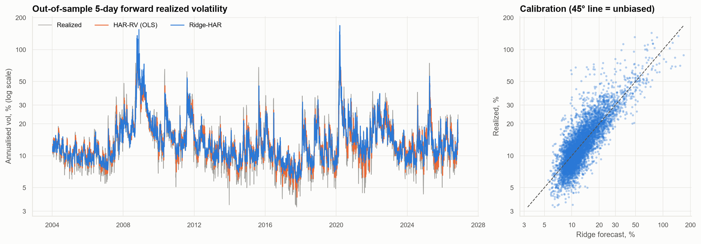
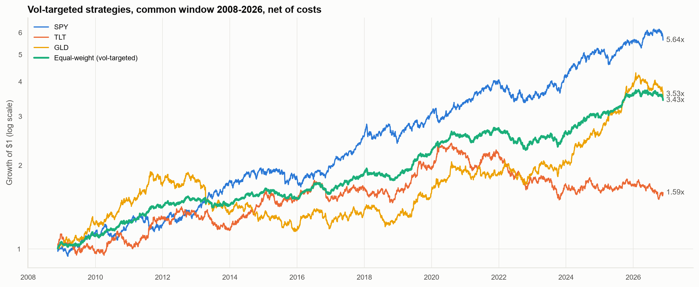
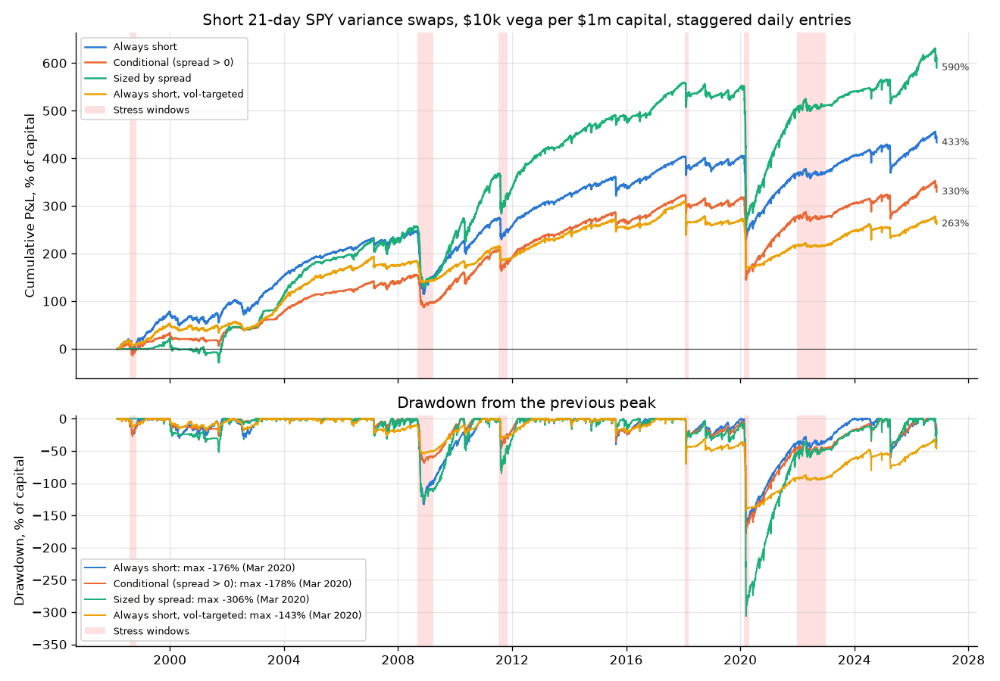
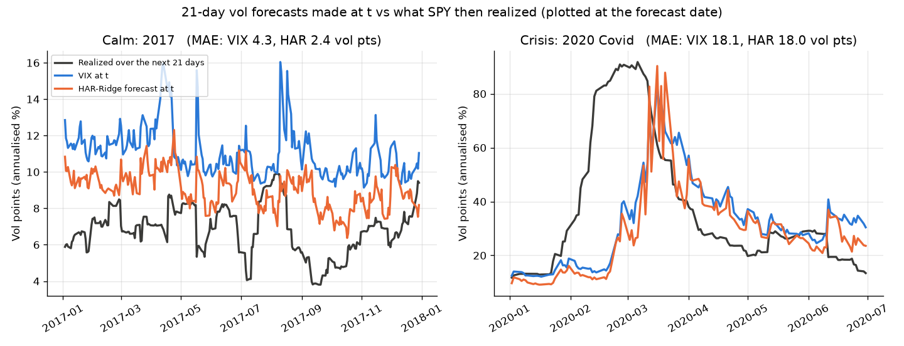

# HAR-Ridge Volatility Forecasting & Vol-Targeted ETF Strategies

[](https://github.com/xtackyy/Vol-Project/actions/workflows/tests.yml)
[](LICENSE)

Out-of-sample forecasting of 5-day and 21-day realized volatility and excess returns, used to size
vol-targeted positions in SPY, TLT and GLD, backtested net of costs and financing.

## Executive summary

- **What is tested.** Ridge on HAR-RV features forecasts forward realized vol. Lasso forecasts forward
  excess returns. Both run at 5-day and 21-day horizons in a purged walk-forward (monthly refits,
  expanding window) and drive a long-only, vol-targeted strategy (12% target, 1.5x cap) on SPY, TLT and GLD.
- **The vol forecast works.** Ridge-HAR beats the classic HAR-OLS benchmark out of sample on all
  three assets: 5-day OOS R² 0.707 vs 0.651 on SPY (Diebold-Mariano t = −9.98).
- **The return forecast does not.** The 5-day Lasso IC is 0.092 (t = 1.74) on SPY and −0.106 (t = −1.30)
  on TLT; on GLD the Lasso keeps no feature at all. At 21 days the models switch themselves off.
- **Vol targeting mainly cuts SPY's drawdowns.** Net Sharpe 0.58 vs 0.52 for buy & hold, max drawdown
  −28.6% vs −55.2% (fills at the next day's open). For TLT and GLD, Sharpe improves by 0.05 and 0.03.
- **SPY's Sharpe edge comes from 2008-09 alone.** Without those two years vol targeting's Sharpe is 0.02
  *below* buy & hold, and it has the higher calendar-year Sharpe in only 2 of 23 years. TLT's and GLD's
  smaller edges are spread out (ahead in 12 of 21 and 10 of 19 years). Source: `reports/stability/`.
- **The three sleeves are nearly uncorrelated** (average pairwise correlation 0.02). An equal-weight book
  has Sharpe 0.80 at 7.1% vol, vs 0.77 for the best single sleeve (SPY) on the same 2008-2026 window.
- **Extension: variance risk premium.** VIX overprices SPY's subsequent vol by 3.7 vol points on average,
  but the HAR forecast does not time a short-vol trade, and every sizing tested is wiped out in a crash
  ([section](#extension-variance-risk-premium)).

## Methodology & anti-leakage safeguards

**Data.** Daily adjusted OHLCV from Yahoo Finance (`yfinance`, open/high/low/close adjusted together),
cached in `data/`. The 13-week T-bill yield (`^IRX`) is the risk-free rate. VIX and asset-specific macro
series are features.

**Vol target.** Log annualized realized vol over days *t+1…t+h*, h = 5 or 21. Daily realized variance is
proxied by overnight gap² + Garman-Klass (range-based, daily bars only).

**Features.** HAR daily / weekly / monthly / quarterly log-vol (Corsi 2009), leverage terms (negative 1d/5d
returns), vol-of-vol, RV slope, momentum and trend, abnormal volume, VIX. Each asset also has a macro block:

| | SPY | TLT | GLD |
|---|---|---|---|
| Macro features | VIX, variance risk premium | 10y yield changes; 10y–3m slope (level, 5d/21d change); SPY–TLT 21d correlation; SPY 5d return; VIX 5d change | Dollar index 5/21/63d returns; 10y yield change; real-rate proxy (−TIP 21d); breakeven proxy (TIP − IEF 21d); VIX stress flag and z-score |
| Cost per unit traded | 1.5 bps | 2.0 bps | 3.0 bps |
| Return prior | 4% p.a. | 1% p.a. | 2% p.a. |

**Safeguards**

| Risk | Control |
|---|---|
| Overlapping labels leaking into training | **Purged** walk-forward: a refit at position *T* trains only on rows with *i + h < T* |
| Hyper-parameter snooping | α tuned by `GridSearchCV` with `TimeSeriesSplit(gap=h)` *inside* each training window |
| α grid too narrow (forced fit) | A warning fires if CV picks the top of the grid in > 20% of refits |
| Scaler fitted on future data | `StandardScaler` lives inside the sklearn `Pipeline`, refit per fold |
| Outside markets settle after the ETF | Every cross-asset series is lagged one day (`shift(1)`). VIX settles 16:15 ET, the ICE dollar index 17:00 ET, Treasury yield indices mid-afternoon; the ETF closes 16:00 ET |
| Different holiday calendars | `align_to()`: as-of join, last value **on or before** each ETF date, never later; feeds stale > 5 days become NaN |
| Trading on the forecast's own close | A weight decided from data up to the close of *t* is filled at the open of *t+1*; the overnight gap belongs to the old position. A same-close fill is reported only as a comparison (section 5) |
| Overlapping errors in tests | Diebold-Mariano uses Newey-West with h − 1 lags + HLN correction; IC t-stats use n / h observations |

**Backtest engine.** Daily, with weight drift between rebalances and a 0.10 no-trade band. Orders fill at
the next day's open: each day is split into the overnight gap (old weight) and open-to-close (new weight),
and the same engine runs the close-fill comparison. Per-asset
trading costs as above. Cash earns T-bills, leverage above 1x pays T-bills + 0.5%, and shorts
(long-short variant only) pay a 0.25% borrow fee.

**Three point-in-time corrections to the position size**
- *Proxy calibration.* The model forecasts the range-based proxy, but P&L variance is close-to-close. A
  trailing 3-year ratio √(Σr²/ΣRV) converts the forecast to close-to-close units.
- *Jensen correction.* exp(forecast of log vol) estimates the median, not the mean, so risk is under-sized.
  The forecast is scaled by √(mean of exp(2e)) over the model's past errors e (Duan smearing), using only
  errors whose label window has closed. With both corrections, a 12% target realizes 11.8% / 11.9% / 12.3%
  on SPY / TLT / GLD.
- *Return prior.* The Lasso intercept (training-window mean return) stayed negative for years after 2008
  and kept the strategy flat. It is replaced by a fixed per-asset prior, so only the feature *tilt* can
  move the position.

**Tests.** 64 tests pass (`pytest -q`, also run by CI on every push). Most work by scrambling or shocking
the future and asserting that the past does not move:

| File | Tests | Checks |
|---|---|---|
| `tests/test_no_lookahead.py` | 14 | Features, calibration and targets are point-in-time; splits are purged; the full scaler → CV → Ridge → forecast stack ignores scrambled future data (all at h = 5 and 21); the Jensen correction uses only matured errors |
| `tests/test_cross_asset.py` | 12 | A shock to an outside series on day *t* leaves features on *t* unchanged; cross-asset features ignore the future; as-of alignment never looks forward; dead feeds become NaN |
| `tests/test_backtest.py` | 6 | Weights applied with a one-day lag; costs scale with turnover; no-trade band; leverage pays rf + spread |
| `tests/test_signal_refinements.py` | 10 | 5-day targets strictly future; 5-day return model ignores the future; EMA/hold smoothing is causal; long-short and short-fee accounting |
| `tests/test_vrp.py` | 14 | VRP labels use only t+1..t+21; variance scaling and signs; the HAR forecast ignores scrambled future prices and contains no VIX; swaps pay strike² − realized variance and ignore the entry day's return; every sizing rule (spread, vol target) uses only data up to t |
| `tests/test_robustness.py` | 8 | Next-open fills never earn the overnight gap after a signal and match close fills when there is no gap; the headline backtest holds yesterday's target; expected-max-Sharpe matches simulation; deflated Sharpe falls as trials rise; the by-year edge check flags an edge from one crisis year |

**Problems found and fixed.** All results below use the corrected code.
- *VIX look-ahead.* The first SPY model used VIX at the same day's close; VIX settles 15 minutes after SPY.
  Lagging it one day moved SPY's vol R² from 0.716 to 0.707 (pre-fix metrics in `reports/pre_vix_fix/`).
- *Lasso grid too narrow.* The old α grid topped out at 10⁻²·⁵, and CV chose that ceiling in 69% of SPY's
  5-day refits, forcing features into the model. The grid now reaches 10⁰, where every coefficient is zero.
- *Jensen bias.* Before the correction above, the 12% target realized 12.5% / 13.3% / 12.8%.

## Empirical results

All results are out of sample and net of costs. SPY is evaluated 2004-01-08 to 2026-11-20, TLT
2006-07-31 to 2026-11-20 and GLD 2008-11-19 to 2026-11-20. Each starts after a 3-year burn-in that
follows the asset's own listing. Unless stated otherwise, horizons are 5 days.

### 1. Volatility forecast (5-day forward realized vol)

| | Ridge-HAR R²_OS | HAR-OLS R²_OS | DM t (Ridge vs HAR) | QLIKE Ridge | QLIKE HAR |
|---|---|---|---|---|---|
| SPY | 0.707 | 0.651 | −9.98 | 0.225 | 0.262 |
| TLT | 0.568 | 0.550 | −2.51 | 0.188 | 0.192 |
| GLD | 0.537 | 0.518 | −3.44 | 0.200 | 0.210 |

R²_OS is measured against the training-window mean. Negative DM t means Ridge has the lower loss.



### 2. Return signal

**Information coefficient** (rank IC of the forecast tilt vs the realized 5-day excess return, on days the
model has a view; t-stat uses n/5 effective observations):

| | IC (5-day) | t-stat | Days with a view |
|---|---|---|---|
| SPY | 0.092 | 1.74 | 31.0% |
| TLT | −0.106 | −1.30 | 14.8% |
| GLD | – | – | 0.0% (no feature survives) |

The 1-day SPY target is weaker still: IC 0.026, t = 1.35.

**Signal study (SPY, 2004-2026, long-only, 4% prior, 0.10 band):**

| Strategy | Gross Sharpe | Net Sharpe | Turnover (x/yr) | Cost drag (bps/yr) | Days flat |
|---|---|---|---|---|---|
| Vol target + 1-day raw signal | 0.53 | 0.48 | 37.4 | 56.1 | 21.3% |
| Vol target + 5-day signal, EMA(5) | 0.59 | 0.58 | 8.2 | 12.3 | 0.0% |
| Vol target only | 0.59 | 0.58 | 8.2 | 12.3 | 0.0% |
| Buy & hold | 0.52 | 0.52 | 0.0 | 0.1 | 0.0% |

The 5-day version is identical to vol-target-only: after smoothing, its signal never overrides the prior.
In 2020-2026 the 1-day signal traded 94.7x a year, for a regime Sharpe of 0.37 vs 0.56 for vol target only.

### 3. Multi-asset

**Vol target vs buy & hold, each asset's full OOS window:**

| | VT Sharpe | B&H Sharpe | VT max DD | B&H max DD | VT vol | B&H vol | VT turnover |
|---|---|---|---|---|---|---|---|
| SPY | 0.58 | 0.52 | −28.6% | −55.2% | 11.8% | 18.6% | 8.2x |
| TLT | 0.21 | 0.16 | −37.5% | −48.4% | 11.9% | 14.9% | 3.8x |
| GLD | 0.52 | 0.48 | −39.1% | −45.6% | 12.3% | 17.3% | 3.3x |

**How the edge is spread over time** (`scripts/stability.py`, Sharpe on excess returns):

| | Sharpe gap, full sample | Gap without 2008-09 | Gap without 2008-09 and 2020 | Years with higher Sharpe |
|---|---|---|---|---|
| SPY | +0.05 | −0.02 | −0.06 | 2 of 23 |
| TLT | +0.05 | +0.05 | +0.06 | 12 of 21 |
| GLD | +0.03 | +0.06 | +0.05 | 10 of 19 |

SPY's whole Sharpe edge comes from avoiding most of the 2008-09 drawdown; in ordinary years the lower
exposure costs more than the steadier sizing gains. Its drawdown protection is the result, not a
better Sharpe. Source: `reports/stability/`.

**SPY targeting buy & hold's vol.** The vol target is raised to 18.6%, buy & hold's realized vol
(2004-01-08 to 2026-11-20, leverage pays T-bills + 0.5%):

| | CAGR | Vol | Sharpe | Max DD | Turnover | Avg exposure |
|---|---|---|---|---|---|---|
| Vol target only (18.6% target) | 10.7% | 16.9% | 0.58 | −41.9% | 7.6x | 1.24x |
| Buy & hold | 10.2% | 18.6% | 0.52 | −55.2% | 0.0x | 1.00x |

It realizes 16.9%, not 18.6%, because the 1.5x leverage cap binds in calm markets. It takes about 10% less
risk than buy & hold, so Sharpe is the fair comparison; the CAGR gap understates it.

**Financing sensitivity.** At 1.24x average exposure, the edge depends on the cost of leverage.
Same forecasts, backtest rerun per borrow spread over T-bills:

| Borrow spread | VT CAGR | B&H CAGR | VT Sharpe | B&H Sharpe | VT max DD |
|---|---|---|---|---|---|
| 0.5% (base case) | 10.7% | 10.2% | 0.58 | 0.52 | −41.9% |
| 1.0% | 10.6% | 10.2% | 0.57 | 0.52 | −41.9% |
| 2.0% | 10.2% | 10.2% | 0.56 | 0.52 | −42.0% |
| 2.5% | 10.1% | 10.2% | 0.55 | 0.52 | −42.1% |
| 4.0% | 9.6% | 10.2% | 0.52 | 0.52 | −42.2% |
| 5.0% | 9.3% | 10.2% | 0.51 | 0.52 | −42.2% |

The CAGR edge is gone at a spread between 2.0% and 2.5%, and the Sharpe edge between 4% and 5%.
The drawdown advantage holds at every spread tested.
Source: `reports/risk_matched_18.6/`.

**Correlation of daily vol-targeted returns** (common window; buy & hold in brackets):

| | SPY | TLT | GLD |
|---|---|---|---|
| SPY | 1.00 | −0.24 (−0.30) | 0.08 (0.09) |
| TLT | −0.24 (−0.30) | 1.00 | 0.22 (0.18) |
| GLD | 0.08 (0.09) | 0.22 (0.18) | 1.00 |

**Equal-weight book of the three vol-targeted sleeves, 2008-11-19 to 2026-11-20 (18.0 years):**

| | CAGR | Vol | Sharpe | Max DD |
|---|---|---|---|---|
| SPY sleeve | 10.1% | 11.6% | 0.77 | −17.1% |
| TLT sleeve | 2.6% | 11.9% | 0.16 | −37.5% |
| GLD sleeve | 7.3% | 12.3% | 0.52 | −39.1% |
| **Equal-weight book** | **7.1%** | **7.1%** | **0.80** | **−16.9%** |

Average pairwise correlation 0.02. Diversification ratio (average sleeve vol / book vol) 1.69.
The book is reset to equal weights daily; that rebalancing costs 2.1 bps/yr and is deducted.



### 4. Forecast horizon: 5 vs 21 days

Same engine with 21-day targets: purge gap, CV gap, DM lag and IC sample all follow the horizon. One
strategy variant was fixed in advance: vol target only, sized on the 21-day instead of the 5-day forecast.

| | Vol R²_OS 5d | Vol R²_OS 21d | DM t 21d | Days with a return view, 21d | VT turnover 5d → 21d | VT net Sharpe 5d → 21d |
|---|---|---|---|---|---|---|
| SPY | 0.707 | 0.611 | −4.11 | 0.0% | 8.2x → 4.9x | 0.58 → 0.58 |
| TLT | 0.568 | 0.571 | −1.03 | 2.5% | 3.9x → 2.2x | 0.21 → 0.21 |
| GLD | 0.537 | 0.577 | −1.26 | 0.9% | 3.4x → 3.2x | 0.52 → 0.52 |

With overlapping 21-day labels there are only ~270 / 240 / 215 effective observations, so only SPY's 21-day
Ridge edge over HAR is significant. Full tables: `reports/horizons/`.

### 5. Robustness: execution timing and multiple testing

**Execution timing.** The headline fills at the next morning's open, so the overnight gap after each
signal is earned by the old position. For comparison, the same target weights are filled at the close
that generates the signal (same costs per unit traded; one engine runs both):

| | Sharpe, next-open fill (headline) | Sharpe, close fill | Max DD, next-open fill | Max DD, close fill |
|---|---|---|---|---|
| SPY vol target only | 0.58 | 0.57 | −28.6% | −28.9% |
| TLT vol target only | 0.21 | 0.21 | −37.5% | −37.1% |
| GLD vol target only | 0.52 | 0.51 | −39.1% | −40.1% |

The result does not depend on the fill time. Source: `reports/execution/`.

**Deflated Sharpe ratio** (Bailey & López de Prado, 2014) for the best of the 192 signal
configurations. It asks whether the best Sharpe beats the best one expected from 192 tries with no skill,
given how widely the trials' Sharpes vary (s.d. 0.28) and the best run's skew and fat tails:

| Test | Best Sharpe | Expected best from luck | Deflated Sharpe, N = 192 | Deflated Sharpe, effective N |
|---|---|---|---|---|
| Best configuration vs zero | 0.62 | 0.76 | 0.25 | 0.33 (N ≈ 114) |
| Best configuration's return over vol target only | 0.25 | 0.61 | 0.03 | 0.06 (N ≈ 81) |

A deflated Sharpe is a probability; about 0.95 would count as significant. Neither test comes close: the
best configuration is what a search of this size produces by chance, and its extra return over plain vol
targeting has no support. Vol target only was fixed before the search, so it is not deflated. The trials
are correlated, so N = 192 is conservative; the effective N (ρ + (1 − ρ)N, ρ the average pairwise
correlation of trial returns) gives the same answer. Source: `reports/experiments/deflated_sharpe.csv`.

## Key research takeaways

- **Vol targeting de-risks equity drawdowns, and far less so elsewhere.** Equity vol rises as prices fall
  (the leverage effect), so cutting exposure as forecast vol rises sells into drawdowns. Max drawdown per
  unit of vol (computed from the table above) falls from 3.0 to 2.4 for SPY. For TLT it barely moves
  (3.3 to 3.1), and for GLD it rises (2.6 to 3.2). In SPY's 2008-09 regime the vol-targeted drawdown was
  −23.6% vs −51.9%. TLT's worst stretch, the 2022-23 rate shock, was a sustained trend rather than a
  crash. Vol targeting scales such a loss down but cannot sidestep it: the 2020-26 drawdown was −37.5% vs
  −48.4%. The Sharpe gain is small for every asset (+0.05 SPY, +0.05 TLT, +0.03 GLD), and for SPY it
  disappears once 2008-09 is removed.
- **Linear daily, weekly and monthly return signals are noise in these ETFs.** No IC t-stat exceeds 1.74 in
  absolute value. Given room to shrink fully, the Lasso drops every feature for GLD at 5 days and for all
  three assets at 21 days. The 5-day signal "recovers" Sharpe only by never acting.
- **The 1-day signal's damage comes before costs, not only from turnover.** Its gross Sharpe was 0.53 vs
  0.59 for vol target only. As a pure timing test (no prior, long-short), it loses money gross (Sharpe −0.06).
- **A slower vol forecast is cheaper at no cost in Sharpe.** Sizing on the 21-day forecast cuts SPY's
  turnover from 8.2x to 4.9x a year, with the same net Sharpe (0.58) and drawdown.
- **Diversification is the clearest gain from the multi-asset extension.** Correlations near zero cut book vol
  to 7.1%, with Sharpe 0.80 vs 0.77 for the best sleeve and a −16.9% max drawdown. In this window the gain
  is risk reduction, not added return. Reaching 12% vol would need about 1.7x leverage and its financing cost.
- **192 signal configurations were tested on one history** (96 settings × long-only / long-short). The best
  net Sharpe was 0.62 vs 0.58 for vol target only. Its deflated Sharpe is 0.25 (0.03 for its edge over vol
  target only), so it is a product of the search, not evidence of skill.
- **Filling at the close instead of the next open changes nothing material.** Sharpe moves by at most
  0.01 on every asset.

## Extension: variance risk premium

**What it tests.** It tests whether S&P 500 options (VIX) systematically overprice the volatility SPY then
delivers, and whether this repo's HAR vol forecast can time a short-volatility trade that harvests that gap.

**Answer.** The premium is large and persistent, but the HAR forecast does not time it. Every way of selling
it at this size is wiped out at least once. The binding problem is the left tail, not the signal.

### Findings

- **The premium is real.**
  - Over 405 non-overlapping 21-day blocks (1993-2026), VIX averaged 19.4 vs 15.8 realized vol.
  - That is a premium of +3.7 vol points, positive in 82% of months (Newey-West t = 13.1 on daily data).
  - It is heavily left-skewed (skew −2.4). The worst block lost 51 vol points (Oct 2008); a Covid entry on
    2020-02-20 lost 69.
- **HAR forecasts realized vol about as well as VIX, but adds little to it.**
  - Out of sample (7,212 days from 1998): MAE 5.20 vs 6.06 for VIX, QLIKE 0.318 vs 0.317 (difference
    insignificant).
  - In an encompassing regression, HAR gets weight 0.22 (t 2.6) on daily data but 0.10 (t 0.45) on
    non-overlapping blocks.
  - VIX minus HAR predicts the next month's premium with slope 0.23 (t 2.6) but R² 0.010.
- **Timing with that spread does not beat always short.**
  - Across all 7 thresholds × 2 roll schemes, the best Sharpe over always short is −0.34 (deflated Sharpe
    0.005).
  - The best raw Sharpe, 0.74 (threshold 4, staggered), is the kind a 14-trial search produces by chance:
    the same threshold gives 0.19 on monthly rolls.
- **Vol-targeted sizing does not stop the wipeouts.**
  - The rule was fixed before it was run: a 10% P&L vol target from trailing 63-day vol.
  - It entered Covid at normal size and Feb 2018 at 1.8× (after a calm 2017), because the shocks arrive
    faster than trailing vol reacts.
- **Only the VIX term structure helped (from 2006).**
  - Staying flat when VIX > VIX3M cut the 2008 loss from −99% to −22% and lifted Sharpe from 0.34 to 0.56.
  - It still lost 108% of capital in Covid and is sensitive to the roll date.
- **The premium is all in the cost assumption, and it has been shrinking.**
  - Always short has Sharpe 0.96 at zero cost, 0.53 at 1 vol point and 0.12 at 2 vol points.
  - Its rolling 12-month Sharpe averaged 1.93 in 1999-2008, 1.31 in 2008-2017 and 1.01 in 2017-2026, and
    was negative on 7%, 21% and 29% of days.

### Results

Synthetic 21-day SPY variance swaps, $10k vega per $1m capital, staggered daily entries (no roll-date luck),
1 vol point cost. Each swap is struck at the VIX close one trading day after its signal. Returns are % of
initial capital, not compounded. A drawdown beyond −100% means the
account was wiped out.

| Strategy (1998-02 to 2026-11) | Ann. return | Sharpe | Max drawdown | Worst month | Covid 2020 |
|---|---|---|---|---|---|
| Always short | 15.1% | 0.53 | −176% | −125% | −148% |
| Conditional: sell only when VIX > HAR forecast | 11.5% | 0.45 | −178% | −125% | −151% |
| Sized by the spread (cap 2×) | 20.6% | 0.49 | −306% | −215% | −259% |
| Always short, vol-targeted (10%) | 9.1% | 0.42 | −143% | −76% | −101% |
| Constant size at the same average risk *(hindsight scale, comparison only)* | 11.4% | 0.53 | −132% | −94% | −111% |
| **From 2006-07 (VIX3M available)** | | | | | |
| Always short | 11.0% | 0.34 | −176% | −125% | −148% |
| Flat when VIX > VIX3M | 13.2% | 0.56 | −122% | −79% | −108% |
| **Tradable check:** long SVXY, compounded, from 2011-10 | 10.6% | 0.54 | −95% | −90% | |

**Cost sensitivity** (staggered, Sharpe; the VIX-scaled cost widens in proportion to VIX above 20):

| Cost per swap | 0 vol pt | 1 vol pt (base) | 2 vol pt | 1 vol pt × max(1, VIX/20) |
|---|---|---|---|---|
| Always short | 0.96 | 0.53 | 0.12 | 0.46 |
| Conditional | 0.83 | 0.45 | 0.08 | 0.40 |
| Always short, vol-targeted | 0.86 | 0.42 | 0.02 | 0.39 |

At 2 vol points, about what OTC spreads widen to in stress, nearly all of the premium is gone.

**Decay** (always short, rolling 12-month Sharpe, sample in thirds):

| | 1999-02 to 2008-05 | 2008-05 to 2017-08 | 2017-08 to 2026-11 |
|---|---|---|---|
| Mean rolling Sharpe | 1.93 | 1.31 | 1.01 |
| Share of days below 0 | 7% | 21% | 29% |

The conditional rule beats always short in 7 of 29 calendar years (`strategy_by_year.csv`).
Sources: `strategy_costs.csv`, `strategy_decay.csv`.





The other figures (implied vs realized with stress windows, VRP histogram, spread vs subsequent VRP) are in
`reports/figures/vrp/`. Every number above comes from `reports/vrp/results.md`,
`results_forecast.md` and `results_strategies.md`.

**How many configurations were tested.** 204 backtest configurations are reported in
`results_strategies.md`: the threshold grid, all 21 roll dates per rule, the backwardation variants, and the
cost and timing checks. None were dropped. The headline threshold (0) and the vol-target rule were fixed
before running.

### Assumptions

- **Synthetic variance swap.**
  - Strike = VIX at entry − 1 vol point (bid-ask haircut; 0.5 also reported).
  - Payoff = notional × (strike² − realized variance), marked to market daily with VIX for the unexpired
    days.
  - No cap on realized variance, no margin calls, no forced liquidation.
- **SPY stands in for the S&P 500.** VIX is a 30-calendar-day SPX quantity; realized vol uses 21 SPY
  close-to-close returns (range-based RV agrees: correlation 0.97).
- **Timing.** Size is decided from data up to t. VIX settles 15 minutes after SPY closes, so the headline
  strikes each swap at the next day's VIX close and the realized leg starts after that. Entering at the
  same close as the signal is reported as a check: Sharpe is unchanged (0.53 always short, 0.45
  conditional).
- **Leakage tests.** The HAR forecast contains no VIX input, and 14 tests in `tests/test_vrp.py` shock or
  scramble the future and check that sizes, labels and forecasts made earlier do not move.
- **Implementation.** Data is cached as CSV (parquet would need pyarrow) and settings live in a dataclass
  (a YAML config would need pyyaml); statsmodels is the only added dependency.

### Limitations

- **Not a tradable P&L.** Real variance swaps are OTC with wider, crisis-dependent spreads. A real book would
  have been closed out by margin calls long before a −176% drawdown.
- **Early HAR forecasts run high.** The Jensen (smearing) correction is estimated from the model's own early
  errors, which include the 1997-98 crises, so 1998-2007 forecasts sit above realized vol. The uncorrected
  forecast is reported alongside (MAE 4.33, QLIKE 0.354).
- **Roll-date sensitivity.** With monthly rolls, Sharpe ranges 0.32-0.65 for always short across the 21
  possible roll dates, which is why the table uses staggered entries.
- **The size is too large, and was left as fixed.** $10k vega per $1m gives always short 28.6% P&L vol,
  about 2.9× a 10% target. It was not re-tuned after seeing the results.

### Next steps

- Price the trade from real SPX option chains (replicating strip or delta-hedged straddles) instead of a
  synthetic swap.
- Use the skew (put vs call implied vol) and the full VIX term structure as conditioning variables.
- Model margin and the size a fixed loss budget allows before the trade is placed.
- Add tail hedges (long OTM puts or VIX calls) and measure what they cost in carry.

### CV bullets

*(placeholder, to be written)*

## Quickstart

Windows PowerShell:

```powershell
python -m venv .venv
.\.venv\Scripts\Activate.ps1
pip install -e ".[dev]"
pytest -q                                      # 64 tests, offline

python scripts\run_backtest.py --ticker SPY    # or TLT / GLD -> reports\<TICKER>\
python scripts\signal_experiments.py           # 192-configuration signal study + deflated Sharpe -> reports\experiments\
python scripts\run_multi_asset.py              # SPY vs TLT vs GLD + equal-weight book -> reports\multi_asset\
python scripts\horizon_comparison.py           # 5- vs 21-day forecasts -> reports\horizons\
python scripts\execution_sensitivity.py        # close vs next-open fills -> reports\execution\
python scripts\stability.py                    # Sharpe edge by year, without 2008-09 -> reports\stability\
python scripts\holdout.py                      # frozen holdout on IWM / EFA / EEM / IEF (see HOLDOUT.md)
python scripts\run_backtest.py --ticker SPY --target-vol 0.186 --output reports\risk_matched_18.6
python scripts\borrow_spread_sensitivity.py    # edge vs cost of leverage at the 18.6% target
python scripts\run_backtest.py --synthetic     # offline: simulated GJR-GARCH market, no download
python scripts\run_vrp.py                      # variance risk premium extension -> reports\vrp\
```

macOS / Linux: the same commands with forward slashes, after activating with `source`:

```bash
python3 -m venv .venv
source .venv/bin/activate
pip install -e ".[dev]" && pytest -q
python scripts/run_backtest.py --ticker SPY
```

The first real-data run downloads prices from Yahoo Finance and caches them as CSVs in `data\`. Later runs
are offline. A full single-asset fit takes about 2-3 minutes. The multi-asset and horizon scripts fit in
parallel, and their `--synthetic` flags give an offline smoke test.

## Repository structure

```
src/volcast/
  config.py        dataclass configs (data, model, strategy) and regime dates
  assets.py        per-ticker profiles: costs, return prior, macro tickers; build_config()
  data.py          yfinance download + cache, as-of alignment (align_to), synthetic market
  features.py      HAR-RV, leverage, trend and macro features; targets; proxy calibration
  validation.py    purged walk-forward splits
  models.py        Ridge / Lasso pipelines (GridSearchCV + TimeSeriesSplit(gap)), HAR-OLS baseline
  strategy.py      vol targeting, Jensen correction, return signal, smoothing, long-only and long-short
  backtest.py      daily engine: next-open (headline) or close fills, drift, no-trade band, costs, financing
  metrics.py       R²_OS, QLIKE, Mincer-Zarnowitz, Diebold-Mariano, IC, Sharpe/Sortino, regimes, deflated Sharpe
  pipeline.py      fit_forecasts() (slow) and evaluate_strategy() (fast)
  plotting.py      report figures
src/vrp/           variance risk premium extension: data, targets, forecast, backtest, evaluate, plots
scripts/           run_backtest, signal_experiments, run_multi_asset, horizon_comparison,
                   execution_sensitivity, borrow_spread_sensitivity, stability, holdout, run_vrp
tests/             leakage, backtest, signal, cross-asset, robustness and VRP tests (64)
reports/           <TICKER>/, experiments/, multi_asset/, horizons/, execution/, vrp/: results, CSVs, figures
```

## Limitations & next steps

- **Noisy vol proxy.** Daily range-based RV. Intraday 5-minute RV would give a cleaner target and a better
  vol forecast.
- **Curve slope.** The 2-year Treasury yield isn't on Yahoo Finance, so TLT uses 10y minus 3-month (`^TNX − ^IRX`).
- **Execution.** Headline results fill at the next day's open. Close fills give the same results
  (section 5), but both assume the same cost per unit traded; opening-auction spreads can be wider.
- **One history.** Every result comes from a single path of each asset, and every setting was chosen with
  that history in view. The equal-weight book has 18 years of data, and GLD's sample starts after most of
  the 2008 crisis. Pre-registered holdouts on untouched assets and a forward test are set out in
  [HOLDOUT.md](HOLDOUT.md).
- **Next steps.** Intraday RV; risk-parity instead of equal weights; more assets (QQQ, IEF) via profiles.

## References

- Corsi, F. (2009). A Simple Approximate Long-Memory Model of Realized Volatility. *Journal of Financial Econometrics*.
- Duan, N. (1983). Smearing Estimate: A Nonparametric Retransformation Method. *Journal of the American Statistical Association*.
- Patton, A. (2011). Volatility Forecast Comparison Using Imperfect Volatility Proxies. *Journal of Econometrics*.
- Moreira, A. & Muir, T. (2017). Volatility-Managed Portfolios. *Journal of Finance*.
- Campbell, J. & Thompson, S. (2008). Predicting Excess Stock Returns Out of Sample. *Review of Financial Studies*.
- Bailey, D. & López de Prado, M. (2014). The Deflated Sharpe Ratio: Correcting for Selection Bias, Backtest Overfitting and Non-Normality. *Journal of Portfolio Management*.
- Diebold, F. & Mariano, R. (1995). Comparing Predictive Accuracy. *Journal of Business & Economic Statistics*.
- López de Prado, M. (2018). *Advances in Financial Machine Learning*. Wiley (ch. 7, purged cross-validation).
- Carr, P. & Wu, L. (2009). Variance Risk Premiums. *Review of Financial Studies*.
- Bollerslev, T., Tauchen, G. & Zhou, H. (2009). Expected Stock Returns and Variance Risk Premia. *Review of Financial Studies*.

## License

MIT. See [LICENSE](LICENSE).
